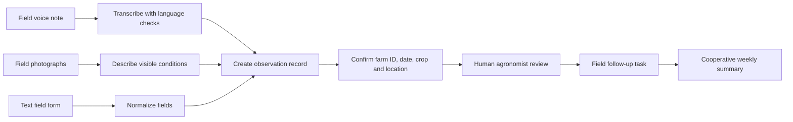

# Case study: a cooperative gathers reports from field officers

**Business:** Agricultural cooperative. **Objective:** Collect consistent field observations through phones and voice notes, route concerns to appropriate experts, and prepare reliable operations summaries. This is not an autonomous pest diagnosis or pesticide recommendation tool.

## The day's reports

A field officer sends a voice note in a local language, two crop photographs and a location description. Another officer sends only text. The cooperative wants a weekly map of reported concerns and follow-up assignments.

## Fields to capture

Farm or plot reference, observation date, crop type, growth stage if supplied, location, rainfall or irrigation report, visible conditions, officer's own assessment, photograph reference, severity *as observed*, and requested assistance. Where the field officer is unsure, retain that uncertainty.

## The mistake to avoid

A photograph showing damaged leaves is not enough to identify the cause. Weather, nutrient issues, insects, disease or handling can produce similar appearances. The assistant can organize observations and prepare questions, but the qualified local adviser should decide on diagnostic or treatment steps, especially where chemicals, food safety or environmental risk is involved.

## No-code value

The gain may come from consistent records: officers no longer send disconnected voice notes into a group where management cannot track them. The system creates dated, assigned follow-up cases. A weekly report then counts **verified reports** and **open cases**, while separating them from confirmed diagnoses.

## Practical field tests

No internet during upload; location names with multiple spellings; noisy audio; several farms with similar owners' names; one photo reused; a record arriving two days late; and a language the speech tool handles poorly. A usable system should preserve the original input and allow staff correction.

**Measures:** Percentage of complete field records, time to assignment, number of unresolved cases, transcription correction rate and staff satisfaction.
