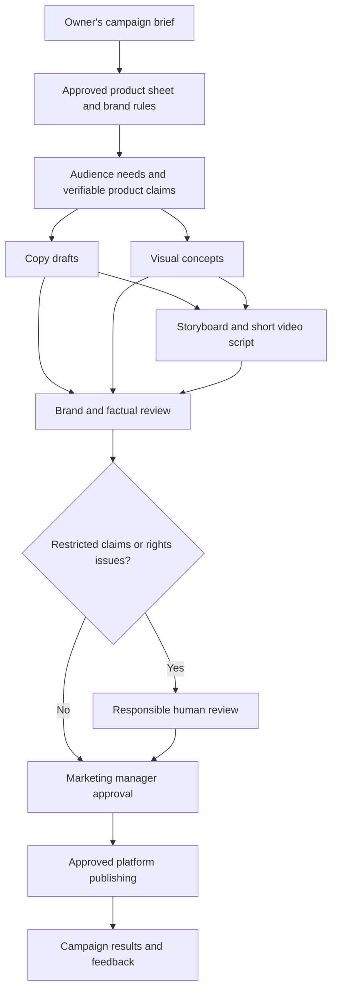

# Case study: a small marketing team builds a campaign

**Business:** A company preparing a three-week product campaign. **Objective:** Coordinate research, copy, images, video drafts and publication approval without inventing product claims or leaking brand assets.

## Campaign brief

The owner wants to promote a new home appliance. Product specifications and pricing are in an approved catalog. The marketing team wants three short social posts, two visuals, a product comparison and a draft short video script. Nothing should be published without approval.

## Give every role a different responsibility

Research gathers customer concerns and verified feature claims. Copywriting writes platform-specific text with clear calls to action. Creative production develops design options from approved assets. Review checks product information, brand voice, trademark use and prohibited promises. Publishing is handled through an authorized channel or scheduled post workflow after final sign-off.

## Claims to scrutinize

“Lasts forever,” “guaranteed to save 50%,” “approved by all experts” and “number one in the market” are not acceptable unless the business has evidence and approval for the exact claim. If the product information says "energy-efficient" without a quantified saving, the campaign should not add a fabricated percentage.

## Sample production card

| Element | Value |
|---|---|
| Campaign goal | Qualified product inquiries |
| Target audience | People comparing appliances for small homes |
| Approved claim | Compact size; warranty as stated in catalog |
| Forbidden claim | Unsupported energy saving percentage |
| Creative deliverables | 3 post drafts, 2 visuals, 1 short storyboard |
| Approval owners | Product manager and marketing lead |
| Publishing status | Draft until approved |

## Common multimodal mistake

A generated product image may look like the actual item but differ in controls, dimensions, ports, labels or safety warnings. That is a serious problem when the asset is presented as a real product photograph. Use approved actual product imagery for factual representation and clearly distinguish conceptual illustrations.

## The feedback loop

After launch, the team reviews inquiries, campaign spend and actual conversions. It may propose a revised message, but should not automatically change product claims or launch new paid advertisements without an agreed spending rule and owner review.

**Measures:** Approved assets completed, corrections per asset, cost per qualified inquiry, publishing mistakes and consistency with product facts.
