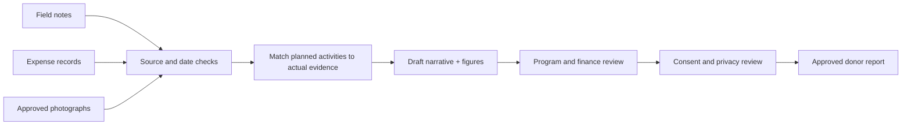

# Case study: a nonprofit produces a donor update

**Business:** Community nonprofit. **Objective:** Prepare a factual progress update from field notes, expense records and consented photographs while protecting beneficiaries' privacy.

## What is difficult

The organization has three kinds of evidence: field staff descriptions of completed activities, receipts showing expenditures, and attendance sheets. The donor wants outcomes, not just a list of activities. The assistant can organize the information but cannot invent impact figures or claim an outcome that has not been measured.

## Separate four statements

| Statement type | Example | Evidence needed |
|---|---|---|
| Activity | “Three workshops were delivered” | Attendance and staff records |
| Output | “Seventy participants attended” | Deduplicated and verified attendance |
| Outcome | “Participants improved skills” | Valid assessment or follow-up method |
| Attribution | “The program caused the increase” | A much stronger evaluation design |

A useful report identifies the difference. If the organization counted 70 attendance entries but some people came twice, it cannot necessarily claim 70 unique people.

## Privacy rules

Photographs involving vulnerable people should be used only with appropriate authorization and consent. Do not include unnecessary names, addresses or sensitive stories in a broadly shared report. A donor's request for more detail does not override the organization's safeguarding policy.

## Testing

Supply a duplicate attendance sheet, an expense in the wrong reporting period, a photograph without approval and a draft sentence claiming causal impact without evidence. The workflow should flag each issue for staff review.

**Measures:** Correction rate, source coverage, time to assemble reports, consistency between finance and program records, and privacy incidents.
