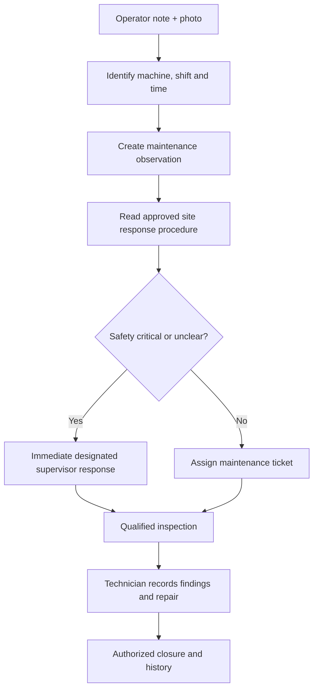

# Case study: a manufacturer organizes maintenance requests

**Business:** Small factory with machines, maintenance staff and shift supervisors. **Objective:** Turn operator observations into consistent maintenance tickets without allowing an assistant to make unsafe operating decisions.

## The event

An operator notices unusual noise and sends a voice message: “Machine four vibrates more than usual. There is a warning light, but it hasn't stopped.” They attach a photograph of the display. The assistant can record the observation and route it according to approved plant procedures, but it must not tell an operator to bypass interlocks or continue operating equipment against the site's safety rules.

## Data required

Machine ID, location, shift, symptom, photographs or recordings, warning codes as observed, whether the operator followed site safety procedures, assignment and technician findings. The assistant should not replace a manufacturer manual, qualified inspection or safety lockout procedure.

## The value of the record

After several months, management can ask how often a particular fault is reported, which parts are delayed, and what tickets remain unresolved. The assistant may summarize patterns but should not assume that every repeated symptom has the same root cause.

## Stress tests

A blurry control-panel photo, similar machine identifiers, repeated reports for the same incident, a note mentioning an emergency, and a supplier PDF with unrelated instructions. Confirm that urgent situations follow the actual human safety route.

**Measures:** Time to log a valid ticket, incomplete ticket percentage, unresolved critical cases, repeat incident patterns, and accuracy of recorded equipment ID.
