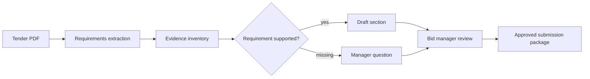

# Fifty everyday business situations, mapped to useful capabilities

This catalog is for the moment when a business owner says, “I understand the technology, but what could we actually use it for?” Each example names a real piece of office work, the information needed to do it properly, and the point at which a human decision matters. These are starter designs, not promises that a product can connect to every system.

## First contact: inquiries and customer care

| Situation | What arrives | Useful capabilities and systems | Where staff remain responsible |
|---|---|---|---|
| 1. New customer asks “what do you sell?” | Message | Find approved service catalog; prepare accurate reply | Approve unusual claims |
| 2. Customer sends a blurred product photograph | Image | Vision describes visible details; catalog search suggests possible matches | Confirm product identity before pricing |
| 3. Voice note asks for 15 units | Audio | Transcribe and confirm number; check inventory | Confirm ambiguous quantities |
| 4. Customer complains about an overdue parcel | Email | Find matching order and delivery event; open service case | Decide compensation |
| 5. Visitor requests an appointment | Web form | Check authorized calendar, suggest slots and create a draft | Handle double-booking or confidential appointments |
| 6. Customer asks in a second language | Message/audio | Translate, preserve product names and numbers, produce a draft | Review sensitive wording and unusual terms |
| 7. Caller asks to change a booking | Phone | Understand request; verify identity; check calendar rules | Approve restricted changes |
| 8. Customer wants a refund | Message + receipt | Locate order, compare policy and draft case | Authorize refund after fraud and payment checks |
| 9. Customer requests another person's order | Message | Identify a privacy-sensitive request | Reject disclosure without authority |
| 10. Incomplete complaint arrives overnight | Email | Ask only for missing order facts; add task to next-day queue | Review difficult cases and service quality |

A simple reception workflow should prioritize truthful responses. If there is no stock connection, it should say availability cannot be verified. If two product variants resemble the photo, the next step is a clarifying question, not a confident guess.

## Sales, proposals and marketing

| Situation | Practical sequence | Most important safeguard |
|---|---|---|
| 11. Inquiry becomes a lead | Extract details, check existing CRM, create qualified lead | Duplicate record protection |
| 12. Client wants a custom quotation | Collect requirements, retrieve approved price list, draft quotation | Pricing and terms approval |
| 13. Sales team missed a follow-up | Review due tasks and produce reminders | Customer consent and contact preferences |
| 14. Prospect sends a long tender PDF | Extract obligations, schedule, deliverables; draft an internal checklist | Human legal/commercial review |
| 15. Sales meeting is tomorrow | Read permitted notes and latest account status | Prevent disclosure of unrelated customers |
| 16. New service launches | Market research, positioning options, campaign brief | Substantiate claims and promises |
| 17. Marketing needs graphics | Draft approved copy, make brand-compliant design concepts | Visual accuracy and rights review |
| 18. Social channel requires a short video | Plan storyboard, generate draft segments, add captions | Publication approval and media rights |
| 19. Company receives competitor newsletter | Summarize public claims and note sources | No unsourced “competitor facts” |
| 20. Monthly campaign report is due | Read approved metrics, calculate results, explain movement | Reconcile figures to source dashboard |

### Longer example: a tender opportunity

A facilities company receives a 65-page tender. The first specialist extracts submission dates, mandatory documents and service requirements. A second compares those requirements with the company's actual qualifications. A third produces a draft response outline. A human bid manager checks contractual commitments, insurance terms and staffing assumptions before anything is submitted. The workflow's measurable success is **no missed mandatory requirements**, not the number of pages generated.

## Finance and supplier administration

| Situation | What the business checks | Human boundary |
|---|---|---|
| 21. New invoice arrives | Supplier, amount, currency, invoice ID, duplicate status | Posting or payment approval |
| 22. Invoice lacks purchase-order reference | Request missing purchase-order link | Never guess the PO |
| 23. Supplier changes bank details | Compare against verified supplier-contact process | Independent verified confirmation |
| 24. Expense receipt is photographed | Extract amount, date, merchant and tax details | Approve policy exceptions |
| 25. Vendor submits two invoices with same ID | Flag duplicates and investigate document history | Resolve actual liability |
| 26. Month-end report needs commentary | Read ledger exports, explain verified differences | Accountant owns official figures |
| 27. Renewal date is approaching | Check contracts and authorized calendar | Decide whether to renew |
| 28. Supplier quotation comparison | Normalize quantities, delivery costs, taxes and lead times | Commercial selection and contractual review |
| 29. Cash forecast is requested | Use source records and explicit assumptions | Treasurer owns funding decisions |
| 30. Audit evidence is requested | Find approved records and prepare a source list | Decide what may be disclosed |

A useful invoice workflow can eliminate repetitive typing without taking control of money. Even a perfect document extraction does not prove the invoice is legitimate or that the supplier has delivered the agreed work.

## Operations, inventory and logistics

| Situation | Workflow outline | Important exception |
|---|---|---|
| 31. Customer asks whether a product is available | Identify SKU; query live stock | Stale inventory data |
| 32. Dispatch needs a morning pick list | Read approved open orders; prepare list | Inventory conflicts and partial stock |
| 33. Driver reports a delay by voice | Transcribe and link route/order | Safety-critical dispatch decisions |
| 34. Delivery note arrives as photograph | Extract signature/date/items for review | Legibility and authenticity |
| 35. Warehouse reports damaged goods | Log photographs and visible condition | Expert determination of disposal or claims |
| 36. Supplier delivery date changes | Update status and draft notices | Contractual promises and penalties |
| 37. Equipment requires maintenance | Combine technician note and asset history | Qualified technician diagnosis |
| 38. Hotel room needs urgent repair | Classify guest report, notify duty team | Safety and access decisions |
| 39. Construction site sends progress pictures | Organize dated photos and draft report | Engineer/site manager certification |
| 40. Catering order changes quantity | Match booking and supplier list | Confirm food safety and final charges |

### Longer example: a service interruption

A water delivery company receives several calls reporting missed deliveries. The system groups reports by delivery route and checks the dispatch record. If the route is late, customer service can prepare factual updates; Operations must approve a new promised arrival time. If the dispatch system has no update, every response must say that an estimate has not been confirmed. Recording the same event across ten calls should create one route incident linked to ten customer cases—not ten contradictory incidents.

## Staff, knowledge and management

| Situation | Proposed use | Human control |
|---|---|---|
| 41. New employee has policy questions | Search approved onboarding handbook | HR interprets unresolved or sensitive cases |
| 42. Staff member requests leave | Collect request and show workflow status | Manager approves leave |
| 43. Meeting ends with action points | Transcribe with consent; draft minutes and tasks | Chair confirms decisions |
| 44. Manager wants a weekly briefing | Combine verified task and performance records | Interpret and decide priorities |
| 45. Recruitment applications arrive | Organize files and required information | Fair human hiring decisions |
| 46. School asks for admissions-status email | Check authorized applicant record; draft response | Staff handles identity and exception cases |
| 47. Nonprofit prepares a donor update | Link expenditure figures and approved outcome evidence | Reporting lead verifies claims |
| 48. Farm team submits field photographs | Organize dates, locations and observed conditions | Agronomist interprets diagnosis/treatment |
| 49. Professional firm needs contract comparison | Identify changes between draft versions | Qualified adviser approves interpretation |
| 50. Business owner asks “what is stuck?” | Read task register, rank unresolved items and assign follow-up | Owner decides priorities and resources |

## How to choose from these fifty

Pick a situation with frequent work, clear inputs, a trustworthy source of truth and an outcome that can be verified. Avoid beginning with high-risk tasks such as payments, medical judgment, dismissals or destructive record changes. If a simple existing rule can accomplish the same job, automate the rule and reserve model-based interpretation for genuinely ambiguous content.

Bring one selected situation to the [process-mapping workbook](../11-workbooks/01-process-mapping.md), then build a permission plan before opening the first connection. For detailed worked examples see the [case-study collection](01-retail-voice-photo-sales.md) and the [business playbooks](../05-playbooks/00-example-library.md).
