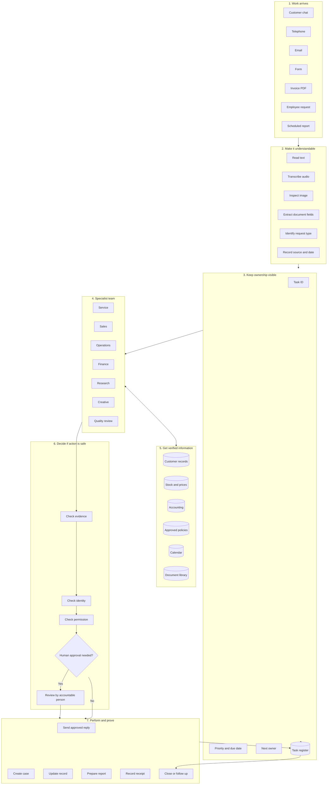
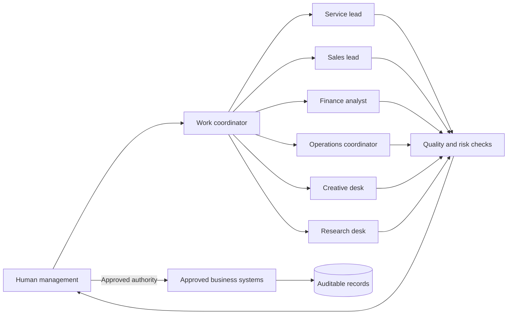

# Company-wide operating map

This is the widest view of a business using a digital workforce. It shows why a conversation is only the front door; the value comes from records, staff handoffs, authorized actions and completion evidence.

**Owner's takeaway:** every real task needs an owner, a source of truth, permission to act and a record showing what happened. You can begin with one narrow route through this map and grow from there.

## Alternative view: division of responsibility

