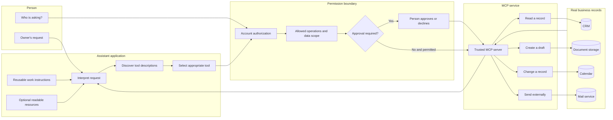
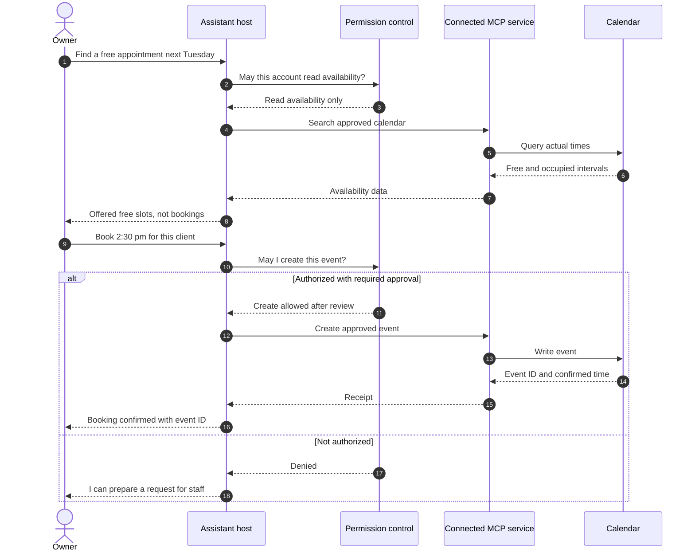

# MCP connection: how work crosses the boundary

The left side is the person and the assistant. The right side is the business service that really owns the data. The assistant can request an operation, but the service must decide whether that operation is allowed.

## Ordinary owner request, detailed sequence

**Remember:** An MCP connection is neither the calendar nor the language model. It gives an approved way for an application to request functions provided by the calendar service.
