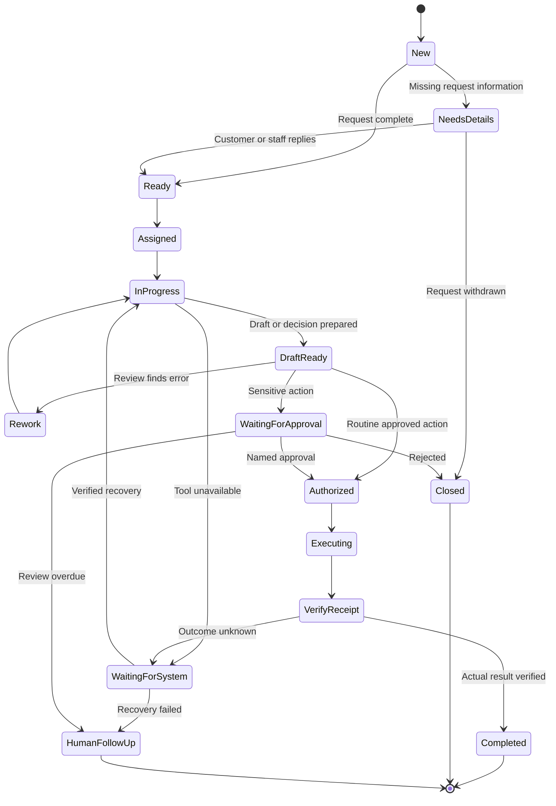
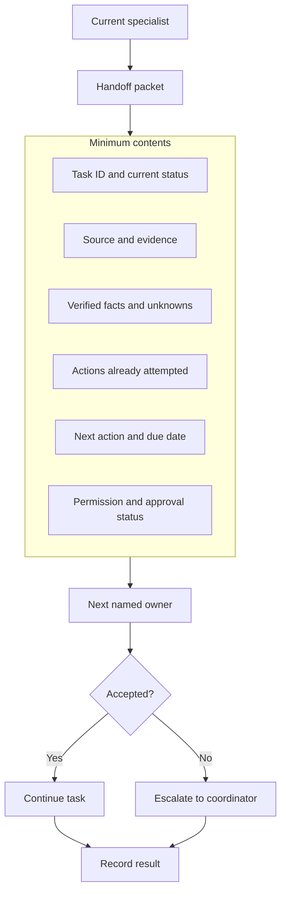

# Task lifecycle and handoffs

This diagram is useful when work is lost between departments. Each state should correspond to a visible record in the task register, with an assigned person or specialist.

## The handoff packet

**Practical check:** if the next person cannot understand a task from its handoff record, the workflow is not ready to run unattended.
