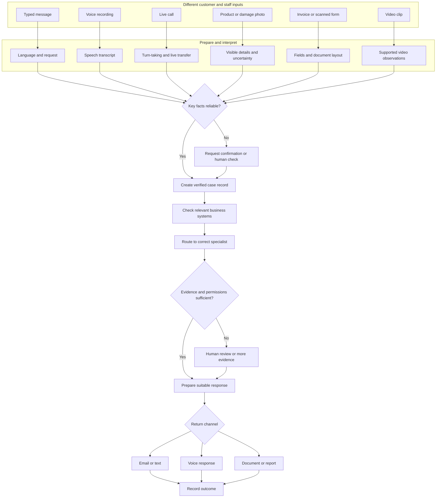
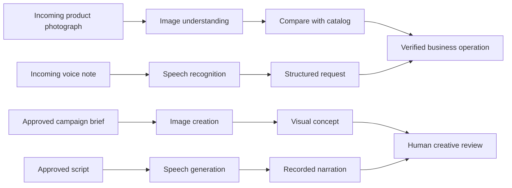

# Multimodal information: six entrances, one task register

This map illustrates why voice, image, document and video handling are separate skills, even when a single app presents them in the same conversation.

## Understanding versus creating

An image maker is not necessarily a reliable visual inspector, and a natural voice generator is not necessarily a telephone receptionist. Test each job with its actual inputs and required outputs.
