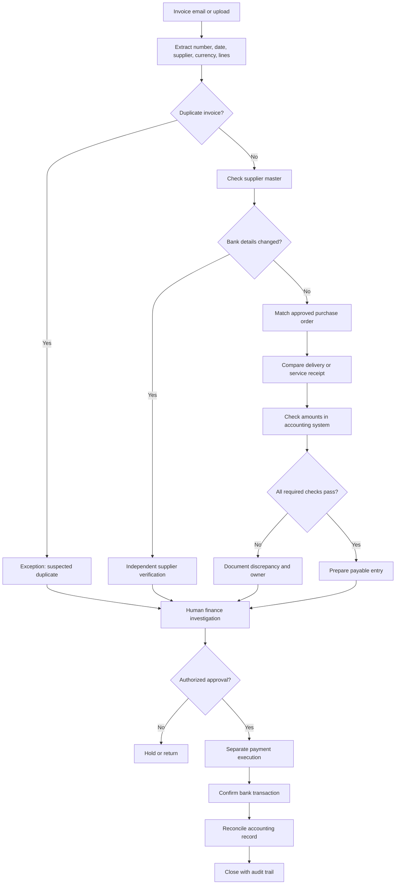
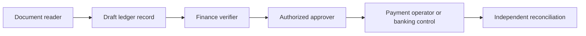

# Finance workflow: from invoice to approved payment

Invoice extraction, expense coding, accounting approval and bank payment are different operations. Combining them without checks can create costly failures.

## Separation of duties

**Owner's check:** the entity that extracts an invoice must not silently become the entity that approves and pays it. Independent confirmation is especially important when a supplier requests new account details.
