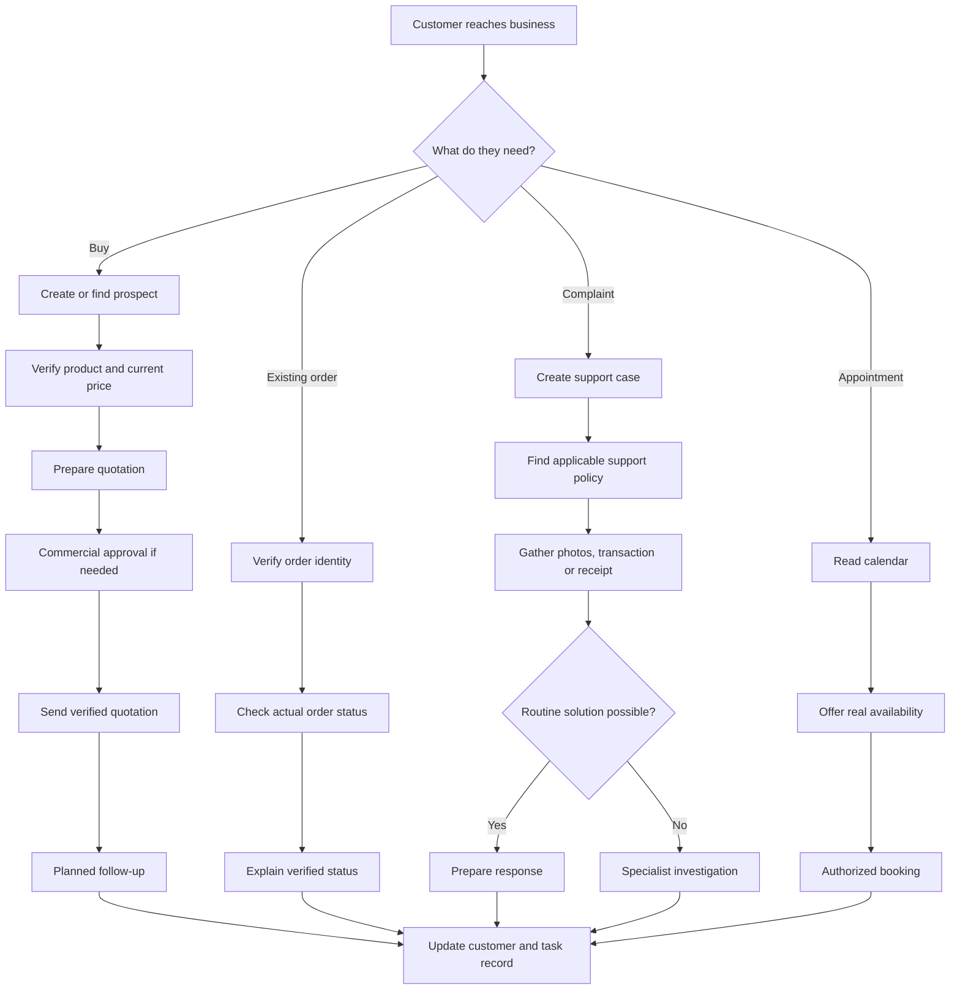
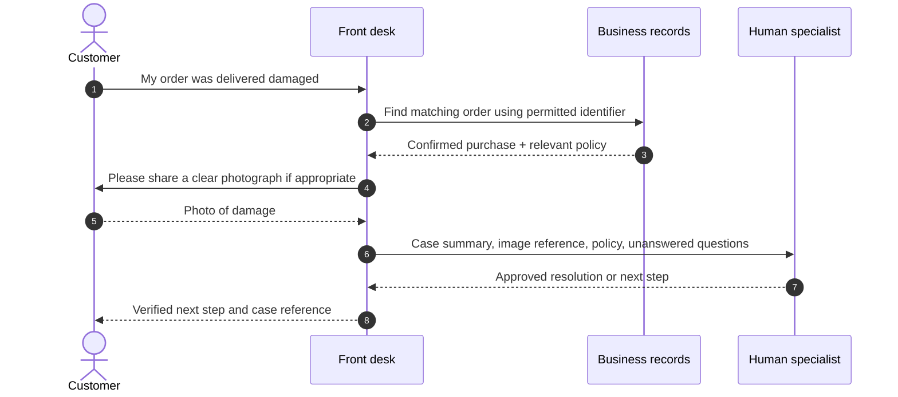

# Customer journey: inquiry, sale, issue and recovery

A strong customer process remembers the case ID, not just the last message. This prevents customers from repeating the same complaint to several departments.

## Customer-service escalation

The diagram intentionally avoids automatic refunding. Payment and return decisions remain subject to business policy and authority.
