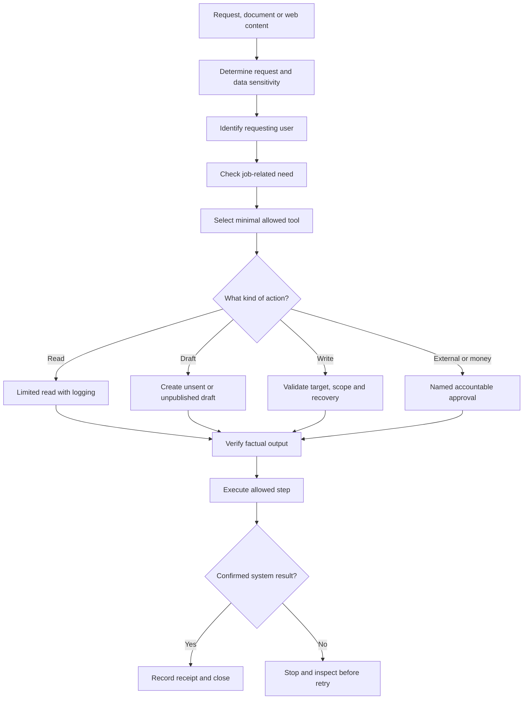

# Governance: permission checks and failure recovery

The assistant is not the final authority over sensitive actions. The company owns the rules and the external systems must enforce them.

## Incident handling

```mermaid
flowchart LR
  ALERT[Unexpected action or disclosure] --> STOP[Pause workflow]
  STOP --> REV[Revoke excess access]
  REV --> PRESERVE[Preserve appropriate evidence]
  PRESERVE --> IMPACT[Identify affected people and records]
  IMPACT --> RESTORE[Correct or restore records if authorized]
  RESTORE --> NOTIFY[Assess legal and contractual notification]
  NOTIFY --> ROOT[Fix underlying cause]
  ROOT --> TEST[Run failing and related tests]
  TEST --> SIGN[Manager signs off restart]
```

The incident path may be shorter or longer depending on severity; a privacy breach needs professional response appropriate to the jurisdiction and the data involved.
