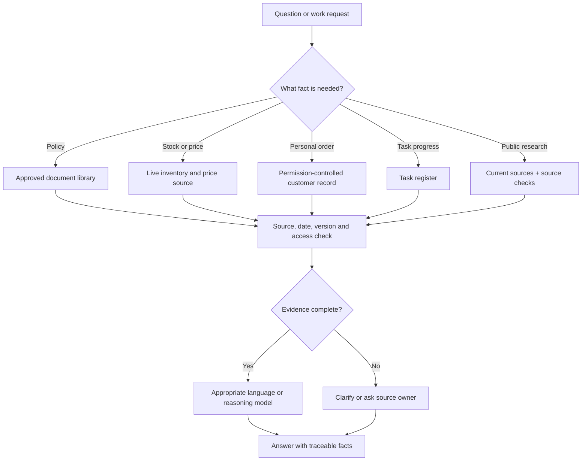
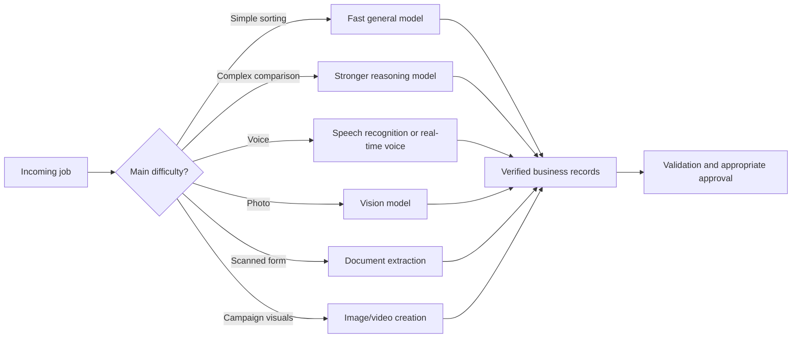

# Company knowledge and the right model for the job

It helps to separate archived reference material from live records, and input understanding from the business decision.

## Model selection by information type

Do not select a costly engine because a vendor says it is "most intelligent." Select the least complex tool that achieves the required verified result.
