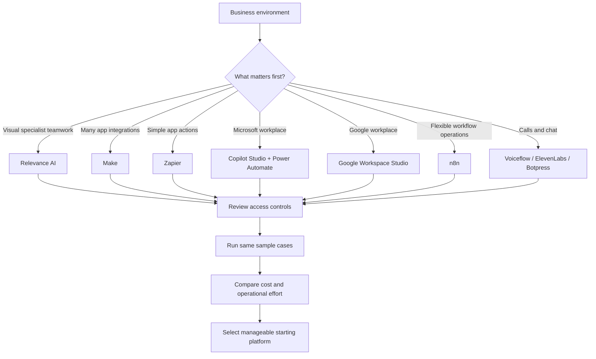
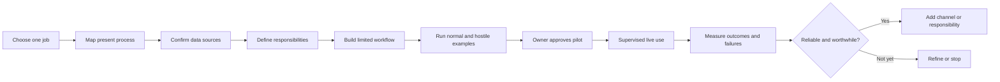

# Platform selection and safe launch

No-code platforms overlap, but their strengths and surrounding ecosystems differ. This map gives a way to shortlist them without treating it as a permanent product ranking.

## Launch as a series of controlled gates

