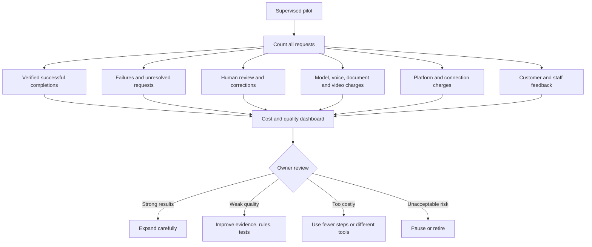
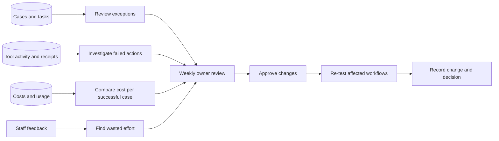

# Measurement: value, quality, cost and responsibility

An attractive response does not prove the business saved time or money. Measure real outcomes, human corrections and the actual cost of the completed process.

## Weekly management review

**Simple dashboard rule:** show total requests, verified completions, unresolved cases, safety events, staff review minutes and total cost. Ratios alone can hide important changes in the total number of cases.
