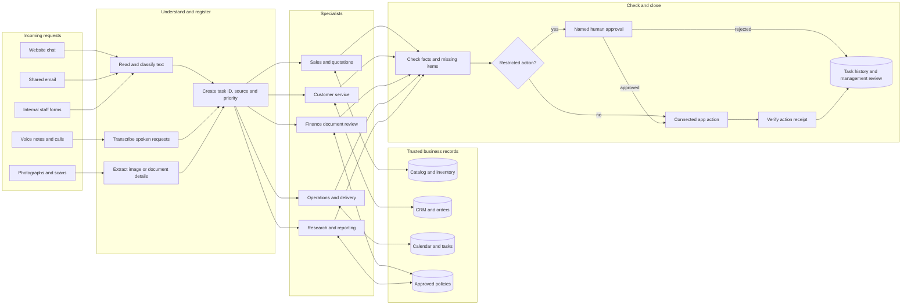
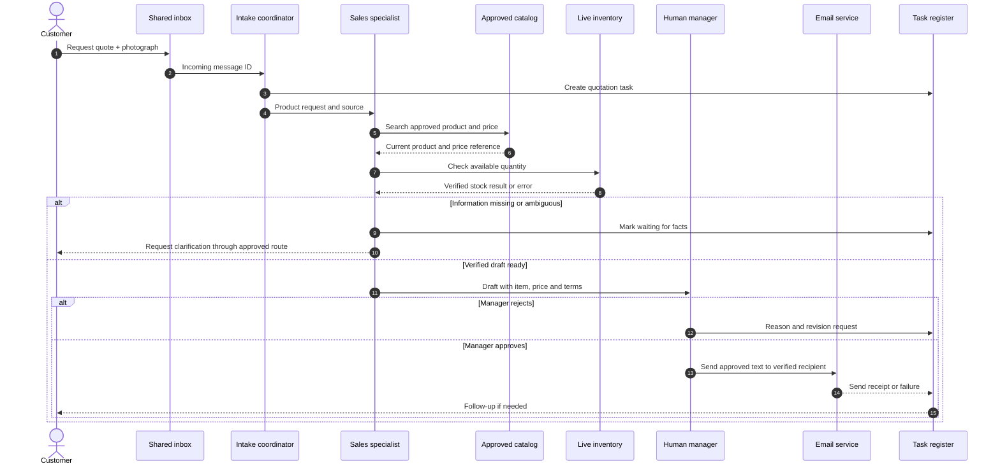
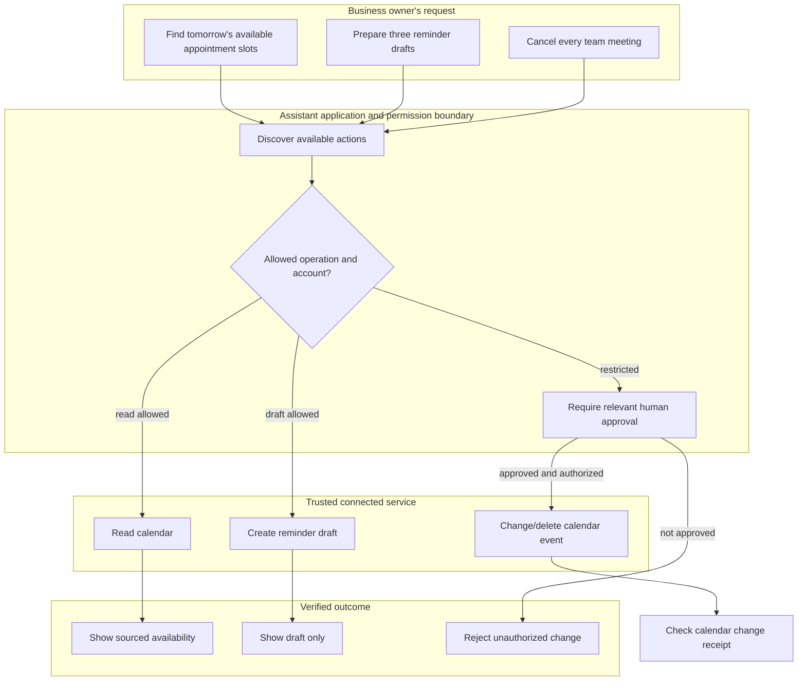
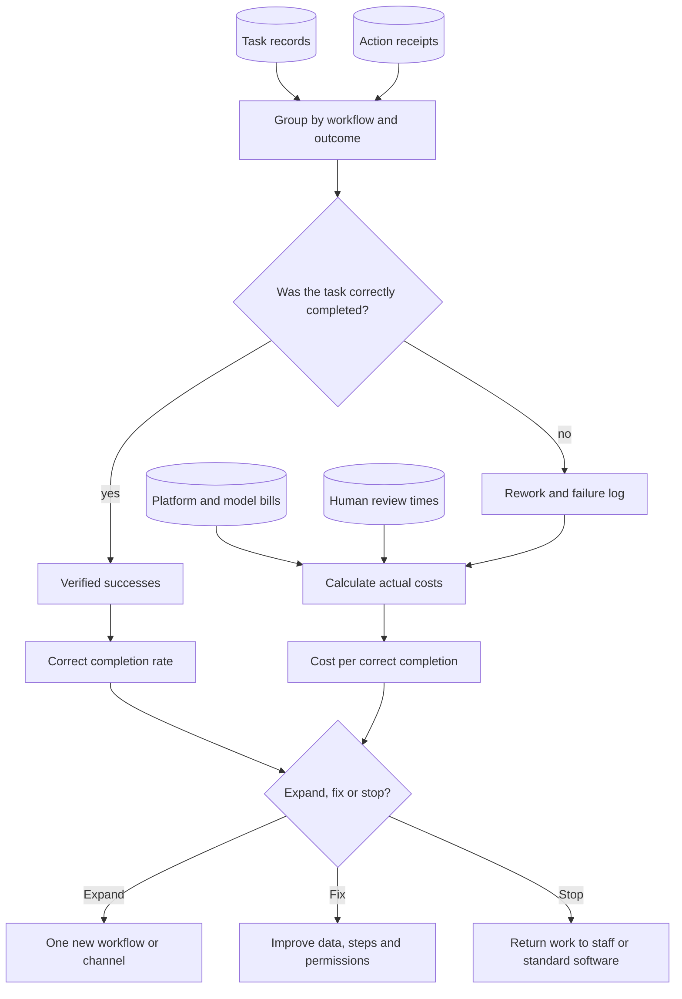

# Large end-to-end illustrations

These are deliberately wide diagrams. Open this file on GitHub and expand the diagram area or use the repository's source view if your screen is small. Every illustration is text-based Mermaid, so there are no image files to maintain.

## One company, many incoming channels, one controlled task system

The arrows show responsibility and information flow; an actual deployment will require specific working integrations. Checking the output may involve opening the calendar, CRM or accounting system rather than trusting the assistant's statement.

## The entire journey of a customer quotation

## What an MCP connection should and should not be allowed to do

## Month-end results without hiding failures

For a narrower view, read the [MCP atlas](02-mcp-expanded.md), [task handoffs](03-task-life-and-handoffs.md), [customer workflows](06-sales-and-service.md), and [cost monitoring](10-cost-and-monitoring.md).
