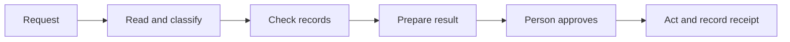

# Workbook: map one process before automating it

Choose a process that runs at least weekly and has a clear end result. Do **not** begin by selecting a model or app. Describe the work an employee performs now.

## The present process

| Question | Your answer |
|---|---|
| What triggers this work? |  |
| Who currently receives it? |  |
| What information is required? |  |
| Where does reliable information live? |  |
| Which steps always happen? |  |
| Which steps require judgment? |  |
| Which actions change records or affect customers? |  |
| Who approves those actions today? |  |
| What proves that the task is finished? |  |
| What happens when a step fails? |  |

## Draw a simple before-and-after map

Replace these six labels with the actual steps. Mark any step that can safely be left unchanged. It is often better to improve one bottleneck than rebuild the whole office.

## A filled example: customer asks for an appointment

A customer calls. Reception checks service type and duration, opens a calendar, offers available times, asks the customer to choose, creates an event and sends confirmation. The source of truth is the live calendar, not a spreadsheet of last month's appointment slots. A successful result is an actual booking ID and the customer receiving the confirmed time.

**Possible automation:** A conversational reception tool collects the request, a calendar connection checks availability, and a controlled booking operation creates the event. **Human fallback:** If the caller has a special requirement or the tool fails, staff receive a case with contact details and reason for escalation.

## Decide whether this is a suitable first process

Good candidate: what does it usually look like?

It repeats frequently, has a clear start and finish, uses reliable records, and has manageable consequences when things go wrong. A human can review early results without doing the entire process again.

Poor candidate: what should make you hesitate?

It has unclear legal authority, depends on unreliable records, changes bank details, requires professional safety judgments, or cannot be reversed after a wrong action. Fix the process and ownership first.

## Decision

**Process owner:** ______  **Proposed test date:** ______  **Current baseline:** ______  **First allowed action:** ______  **Forbidden actions:** ______
