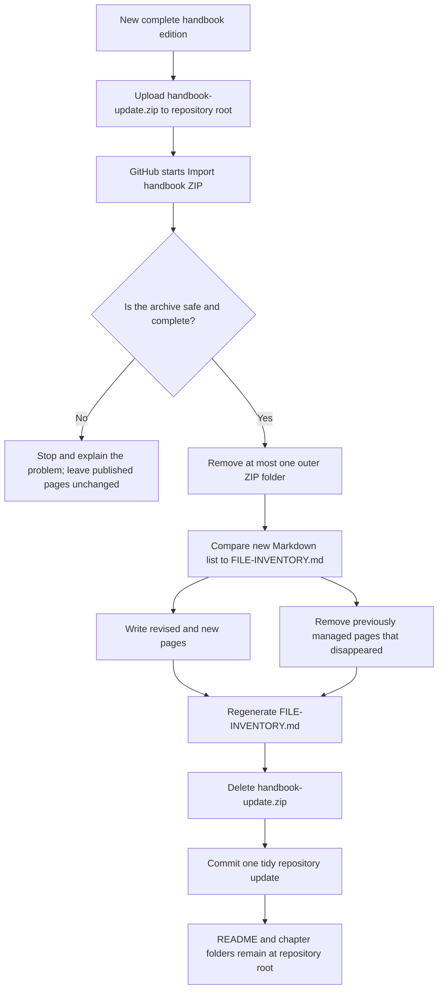

# Keep the handbook up to date

A single ZIP file can replace the handbook's published Markdown without creating another copy of the repository inside itself. This page explains the update process in plain language.

> **A future ZIP is a complete edition, not a small patch.** Every handbook page you want to keep must be included in the new archive. Pages from the previous edition that are absent from the next archive are removed automatically. Unrelated repository files and the workflow itself are left alone.

## The clean repository layout

When you open the repository in GitHub, you should see `README.md` **immediately at the top**. Subject folders appear beside it, not inside another folder named after the repository.

```text
README.md
IMPORTING-UPDATES.md
FILE-INVENTORY.md
CHANGELOG.md
CONTRIBUTING.md
EDITORIAL-STANDARDS.md
PUBLICATION-CHECKLIST.md
00-start-here/
01-foundations/
02-models/
03-connections/
04-no-code/
05-playbooks/
06-management/
07-templates/
08-deep-dives/
09-case-studies/
10-diagram-atlas/
11-workbooks/
reference/
.github/
  workflows/
    import-handbook.yml
```

**There should be no permanent ZIP file in the repository.** During an update, you briefly upload `handbook-update.zip` at the root. The workflow unpacks it and deletes the uploaded archive in its own commit.

## First-time setup — no manual extraction needed

You can publish the entire handbook with **two uploads**: the workflow file, followed by the ZIP.

1. Create an empty repository on GitHub. For the simplest first run, do not ask GitHub to create another README.
2. Open the repository and choose **Add file → Create new file**. In the filename box enter `.github/workflows/import-handbook.yml`. GitHub creates the two folders as you type the path.
3. Open the **separately supplied** `import-handbook.yml`, copy its contents into the editor, and commit that file.
4. Return to the repository root and choose **Add file → Upload files**. Upload the supplied **`handbook-update.zip`** without unzipping it. Commit the upload.
5. Open **Actions → Import handbook ZIP**. The workflow checks the archive, puts all Markdown files in their proper places, creates `FILE-INVENTORY.md`, and deletes the uploaded ZIP.
6. Refresh the repository. `README.md` should now appear at the root, with all subject folders beside it. Open the README and check that the diagrams and chapter links render.

This method also works for future editions; you never have to upload individual chapter files or create another handbook folder. If your organization disables Actions, an administrator must enable the workflow and permit its required repository write access.

**Alternative:** You may unzip the archive and upload its Markdown contents manually, then install the workflow for future editions. If you choose that method, upload **the contents** of the extracted folder, not the enclosing folder.

The generated `FILE-INVENTORY.md` records which handbook pages the importer owns. It is ordinary Markdown, and the workflow maintains it automatically.

## Update the handbook later

1. Get the newest **complete handbook edition** as a ZIP.
2. Name the ZIP exactly **`handbook-update.zip`**. You can use the ZIP supplied with this guide without renaming it.
3. Open the root of your GitHub repository. Choose **Add file → Upload files**.
4. Upload `handbook-update.zip` at the root, beside `README.md`. Commit the upload to the branch where you keep the handbook.
5. Open the **Actions** tab, then **Import handbook ZIP**. Watch the newest run.
6. When it finishes successfully, refresh the repository. The revised Markdown is in place, removed chapters are gone, and `handbook-update.zip` has been deleted.

You can also open **Actions → Import handbook ZIP → Run workflow** to retry an upload that is already present in the repository. Running it without an uploaded ZIP produces a useful error instead of silently doing nothing.

### What the workflow checks before it makes changes

- The archive contains only Markdown documents (apart from harmless operating-system archive metadata).
- Its first visible page is `README.md`, either directly at the root or inside **one** wrapper directory that can safely be removed.
- There are no duplicate file paths, case-conflicting names, or identical copies of the same file.
- Files use valid text encoding, and unsafe paths such as `../outside.md` are refused.
- The archive contains no scripts, links to filesystem locations, GitHub workflow files, or non-Markdown assets.
- Markdown code blocks are properly closed and internal Markdown links point to pages in the same edition.
- The compressed archive cannot expand beyond the file-count and size limits configured in the workflow.

If these checks fail, the import **stops without replacing handbook pages**. Correct the ZIP and upload a new one. The failure is intentional: a red run is preferable to a broken publication.

## How the update works



## What gets removed and what stays

| Item | On a successful import | Reason |
|---|---|---|
| A chapter present in both editions | Updated only if its text changed | No second copy |
| A chapter missing from the new ZIP | Removed if previously listed in `FILE-INVENTORY.md` | No outdated edition remains |
| A new chapter | Added in its actual folder | New content becomes available |
| `FILE-INVENTORY.md` | Regenerated | Keeps future cleanups accurate |
| `handbook-update.zip` | Deleted | No archive accumulating in the repository |
| `.github/workflows/import-handbook.yml` | Left alone | An archive cannot replace the update mechanism |
| A non-handbook file outside the inventory | Left alone | The importer does not claim ownership of unrelated files |

**Do not edit `FILE-INVENTORY.md` by hand.** Editing a handbook page directly in GitHub is possible, but the next full-edition import can replace that page. Keep intentional changes in the next ZIP as well.

## If an update does not finish

| What you see | Most likely reason | What to do |
|---|---|---|
| The workflow does not start | ZIP has the wrong name or was uploaded to the wrong folder | Upload `handbook-update.zip` at the repository root |
| “README.md must be at the archive root” | ZIP contains several nested wrapper folders | Rezip the contents of the actual handbook folder, not its parent folders |
| “Duplicate Markdown content” | Two files contain exactly the same document | Keep one copy, or make the second chapter genuinely distinct |
| “Broken Markdown link” | A page links to a chapter missing from the new edition | Include that chapter or update the link |
| “Only Markdown is allowed” | ZIP includes images, scripts, PDFs or workflow files | Remove non-Markdown items from the archive |
| `git push` fails | Branch protection, token permissions, or repository rules prevent automated commits | Ask a repository administrator to allow this workflow's commit or use a reviewed update branch |
| Archive still appears after failure | The import did not reach its cleanup step | Fix the error; do not delete the uploaded archive until you understand the failure |

### Permissions and protected branches

The workflow declares `contents: write`, because it must update chapters and remove the temporary ZIP. The repository or organization may impose stricter restrictions. A protected branch may reject automated commits even when validation succeeds. That is a repository setting, not a defect in the archive. In such repositories, use a reviewed branch and merge process, or ask an administrator to approve an appropriate policy. Do not bypass required review simply to make the status turn green.

## Before you publish a new edition

- [ ] Open the archive and check that `README.md` is at the first level, or inside only one outer folder.
- [ ] Include every existing chapter you intend to keep.
- [ ] Keep the archive Markdown-only.
- [ ] Verify the README and main chapter links.
- [ ] Check that no customer details, passwords, access tokens, or confidential information are included.
- [ ] Review the import commit and confirm no unrelated documents changed.
- [ ] Open the rendered Mermaid diagrams in GitHub after the update.

The aim is simple: **one visible handbook, one current set of pages, and one controlled route for future editions.**
