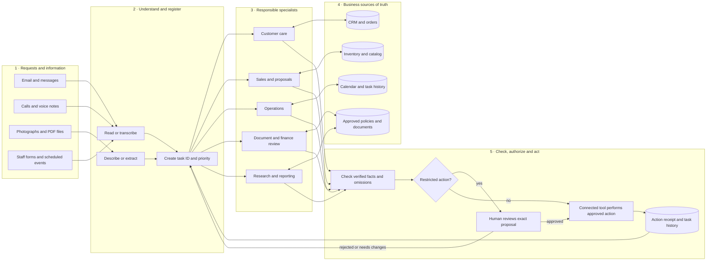
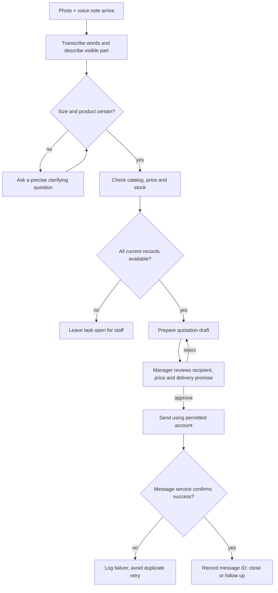

# The Connected Business Handbook

### A field guide to building a capable, supervised digital workforce—without programming

A customer sends a voice note after closing time. Another attaches a photograph of a damaged product. A supplier emails an invoice, while a manager asks why three deliveries are late. None of these jobs ends when a reply is written. Somebody must check the right records, make a decision within their authority, complete the permitted action, and leave an understandable trail for the person responsible.

This handbook shows how to arrange that work using specialist models, visual workflow builders, business applications, and Model Context Protocol (MCP) connections. It is written for the people who **own and manage the process**, not only the people who build technology.

You do not need to write code to follow the exercises. You do need to understand your business, know where trustworthy information lives, choose who may take which action, and test whether the result is real.

> **The central rule:** A polished message is not a completed job. The job is complete when the relevant business system confirms the action, the records agree, and the next responsible person can see what happened.

**Use this book if you are:** a business owner assessing an opportunity; an operations or department manager improving routine work; a consultant designing an implementation for a client; or a team lead responsible for safe access, quality and ongoing review.

**Format:** Every handbook file is ordinary Markdown. The illustrations use Mermaid diagrams rendered directly by GitHub. Expandable explanations use GitHub-compatible `
` sections. There are no binary images, scripts, software projects, font files or hidden media assets. The diagrams help you understand processes; they do not execute them.

---

## Start with the question you have today

| Your question | The best starting point | What you will be able to decide |
|---|---|---|
| **Where do I begin?** | [The plain-English introduction](00-start-here/01-read-this-first.md), then [choose one job](00-start-here/02-pick-your-first-job.md) | Whether your first process is suitable for a no-code pilot |
| **How does a whole team coordinate?** | [The complete operating design](08-deep-dives/05-the-complete-workforce-architecture.md) and [handoffs](01-foundations/03-coordination-and-handoffs.md) | What each specialist does and how unfinished tasks move |
| **What exactly is MCP?** | [The owner's MCP manual](08-deep-dives/01-mcp-business-owner-masterclass.md) and [permission lab](08-deep-dives/02-mcp-permission-lab.md) | What a connection opens up and how to limit it |
| **Which models should I use?** | [Model families explained](08-deep-dives/03-models-explained-for-owners.md), [model selection](08-deep-dives/04-model-selection-decision-trees.md), and the [comparison exercise](11-workbooks/03-model-bakeoff.md) | Which capability belongs in each part of a job |
| **Which no-code platform?** | [Platform decision workshop](04-no-code/13-platform-decision-workshop.md) and [provider trial guide](08-deep-dives/19-provider-demo-and-proof-of-capability.md) | What to test before paying or connecting accounts |
| **Give me real business examples.** | [Fifty everyday situations](09-case-studies/13-fifty-everyday-business-situations.md) and the [full case studies](09-case-studies/01-retail-voice-photo-sales.md) | How to turn an idea into a task, record and approval flow |
| **I want clear diagrams.** | [Large illustrations](10-diagram-atlas/11-large-end-to-end-illustrations.md) and the [diagram atlas](10-diagram-atlas/README.md) | How information, decisions and permissions fit together |
| **How do I run this safely?** | [Approval controls](06-management/02-approvals-and-permissions.md), [security walkthrough](08-deep-dives/09-security-and-trust-walkthrough.md), [testing](06-management/04-testing.md) | What must remain under human authority |
| **How do I work out the cost?** | [Business-case analysis](08-deep-dives/10-owner-economics-and-business-case.md), [cost worksheet](11-workbooks/07-cost-calculation.md) | Whether savings are likely to survive errors and review costs |

### New to the subject? A short reading path

Read [what a digital employee actually does](01-foundations/01-what-an-employee-is.md), then [the difference between models, apps and workflows](02-models/01-models-apps-and-workflows.md). Next, learn [why a live connection matters](03-connections/01-mcp-explained.md). Finish with the [thirty-minute design exercise](00-start-here/03-thirty-minute-exercise.md). These four chapters provide the vocabulary needed for the rest of the book.

### Already running a business process?

Begin with your actual incoming requests. Use the [process map](11-workbooks/01-process-mapping.md), the [permission exercise](11-workbooks/02-permission-exercise.md), and the [launch readiness worksheet](11-workbooks/10-launch-readiness.md). You can fill these documents in without choosing a vendor.

---

## The whole operation, illustrated

The following drawing follows one task from an incoming request through interpretation, assignment, live business records, permission checks and a verified outcome. It is intentionally wide; use GitHub's diagram viewer if you prefer more room.

**What this diagram does not mean:** All connections do not automatically come with a model subscription. A workflow builder, MCP service, calendar account and finance system may be separate products with different permissions, plans and charges. Each arrow has to correspond to an actual approved integration or human handoff.

## Six distinctions that prevent costly mistakes

| Term | In plain language | It provides | It does not provide by itself |
|---|---|---|---|
| **Model** | The engine that interprets or creates information | Reasoning, writing, vision or another capability | Your live inventory, company authority, or confirmed actions |
| **Application** | The product employees interact with | An interface, user accounts and product features | Every possible model or every business integration |
| **Specialist / agent** | A defined worker with instructions and available tools | Focused work within a role | Guaranteed accuracy or legal responsibility |
| **Workflow builder** | A visual sequence of triggers, steps and decisions | Routing, scheduled work, conditional steps, records and approvals where supported | Automatic understanding of every business exception |
| **MCP connection** | A standard route for an assistant to use external capabilities | Described tools, data resources or reusable prompts | Unlimited business access or independent authorization |
| **Business system** | The authoritative operational record | Real orders, appointments, prices, invoices and related evidence | Permission for a model to change those records |

For a full explanation with practical side-by-side examples, see [automation versus agents versus MCP](08-deep-dives/08-automation-vs-agent-vs-mcp.md).

---

## A business example: the quotation that should not be sent yet

A customer sends a photograph and asks for 12 units of a part by Thursday. The voice note sounds like “half-inch,” but the photograph could show two sizes. The business assistant must not pick the most likely size and send a price. A correct process transcribes the note, inspects the image, checks an approved catalog, and asks the customer for confirmation. Only after the exact item is known can Sales retrieve current pricing and Operations check available stock.

The proposal then goes to the authorized manager, who sees the item, price reference, quantity, delivery commitment and exact customer message. A rejection returns the task for correction. An approval allows the permitted sending tool to act, and its receipt is recorded. If the email service fails, the task remains open.

This is the difference between a beautiful demo and a dependable office process. Read the full [retail case study](09-case-studies/01-retail-voice-photo-sales.md) for a complete example and the [connected actions guide](08-deep-dives/12-connected-actions-and-retries.md) for failure and retry handling.

## What you can build without writing code

Visual platforms can help staff set up task routing, knowledge search, document extraction, voice reception, message drafts, CRM updates, calendar queries and approval checkpoints. The exact scope depends on your plan, region, integrations and company accounts.

| Main concern | Products worth evaluating | Where to start in this book |
|---|---|---|
| Teams of collaborating specialists | Relevance AI | [Full visual workforce walkthrough](04-no-code/06-relevance-workforce-full-build.md) |
| Work across many existing apps | Make | [End-to-end connected workflow](04-no-code/07-make-full-build.md) |
| Google Workspace-centred office routines | Google Workspace Studio | [Google guide](04-no-code/08-google-workspace-studio-full-build.md) |
| Microsoft 365 and Power Platform | Copilot Studio | [Microsoft guide](04-no-code/09-copilot-studio-full-build.md) |
| Straightforward app automation | Zapier / AI by Zapier | [Zapier guide](04-no-code/10-zapier-full-build.md) |
| More flexible visual logic and tool approval | n8n | [n8n guide](04-no-code/11-n8n-visual-workflows.md) |
| Customer-facing voice and messaging | Voiceflow, ElevenLabs, Botpress | [Voice and messaging guide](04-no-code/12-voice-and-messaging-platforms.md) |

**Do not buy the entire stack at once.** Many projects only need one visual builder, an existing inbox or spreadsheet, and the business's current record system. Add specialist audio, image or document tools only when the job calls for them.

### Your first no-code pilot, from start to evidence

1. **Choose one repeatable problem.** Examples: sorting incoming inquiries, preparing quotation drafts, or extracting invoice fields for staff review.
2. **Define completion.** “A categorized task with the correct source email ID” is testable. “Better productivity” is not.
3. **Identify the source of truth.** Decide which document or live system determines each important fact.
4. **Draw the process first.** Mark questions, decisions, exceptions and human approvals. Use the [process worksheet](11-workbooks/01-process-mapping.md).
5. **Restrict the initial connections.** Begin with read and draft operations where possible. Keep money, deletion and sensitive data changes outside the initial scope.
6. **Create the smallest working team.** Usually an intake role, one specialist and a reviewer or human owner are enough.
7. **Test realistic and hostile cases.** Include unavailable tools, duplicates, blurry pictures, contradictory records and attempted permission bypasses.
8. **Open a controlled pilot.** Track actual business outcomes, review time, failures and costs, then decide whether to grow, change or stop.

A full deployment roadmap appears in the [90-day management plan](06-management/07-ninety-day-plan.md) and the [90-day workbook](11-workbooks/14-ninety-day-planner.md).

---

## Three non-negotiable controls

**Check the underlying record.** If the system claims that it booked an appointment, inspect the booking ID and actual time. If it claims that an invoice was posted, inspect the authorized accounting record. A generated confirmation is not proof of the action.

**Keep authority separate from capability.** A model may be capable of forming a payment request or composing a refund email. That does not mean it is authorized to issue a payment, grant a refund or make an irrevocable promise. Tool permissions must enforce boundaries independently of written instructions.

**Never let an unread message rewrite the rules.** Emails, websites, documents and customer attachments may contain text that attempts to command the connected assistant. These are inputs to interpret, not new authority. A review step alone does not compensate for unrestricted system access.

For risk management, begin with the [permission guide](06-management/02-approvals-and-permissions.md), [MCP safety](03-connections/05-mcp-safety.md), and the [security workshop](08-deep-dives/09-security-and-trust-walkthrough.md).

---

## Explore the complete library

The folders are ordered for learning, not importance. Read the foundational chapters once, then use the practical sections as reference material while building and running your system.

| Folder | Purpose |
|---|---|
| `00-start-here` | Decide whether a job is suitable and how to start |
| `01-foundations` | Understand specialist roles, handoffs and company knowledge |
| `02-models` | Learn model families, specialist capabilities and tests |
| `03-connections` | Understand MCP, connected tools and permission boundaries |
| `04-no-code` | Follow visual-builder walkthroughs and choose a platform |
| `05-playbooks` | Reusable processes for sales, service, finance and operations |
| `06-management` | Governance, testing, incident response, costs and rollout |
| `07-templates` | Copyable job cards, registers and review forms |
| `08-deep-dives` | Long-form explanations of architecture, MCP and business economics |
| `09-case-studies` | Full business scenarios and a catalog of fifty daily situations |
| `10-diagram-atlas` | Larger Mermaid drawings that explain complete workflows |
| `11-workbooks` | Exercises and practical planning tools |
| `reference` | Glossary, evidence, FAQ and publication advice |

### Full chapter index

The lists below expand in GitHub. Each item is a real Markdown file. Every chapter can be read separately, and internal links work without an external website.

<strong>Start here</strong> — 3 chapters

- [Read this first: what are we trying to build?](00-start-here/01-read-this-first.md)
- [Pick your first job](00-start-here/02-pick-your-first-job.md)
- [A 30-minute exercise before buying anything](00-start-here/03-thirty-minute-exercise.md)

<strong>Foundations</strong> — 5 chapters

- [What a digital employee actually is](01-foundations/01-what-an-employee-is.md)
- [Capabilities first; departments second](01-foundations/02-capabilities-and-departments.md)
- [Coordination and handoffs: how work moves between specialists](01-foundations/03-coordination-and-handoffs.md)
- [Working with messages, voice, photographs, documents, and video](01-foundations/04-multimodal-work.md)
- [Company knowledge and memory](01-foundations/05-knowledge-and-memory.md)

<strong>Models and capabilities</strong> — 5 chapters

- [Models, apps, workflows, and connections are different things](02-models/01-models-apps-and-workflows.md)
- [Which model should a business use?](02-models/02-model-guide.md)
- [Choosing models through a fair test](02-models/03-choose-and-test.md)
- [Specialist services: listening, seeing, reading, drawing, and video](02-models/04-specialist-models.md)
- [Choosing the right model for a real business task](02-models/05-practical-model-choices.md)

<strong>Connections and MCP</strong> — 6 chapters

- [MCP explained without technical jargon](03-connections/01-mcp-explained.md)
- [Ten ways a business owner could use MCP](03-connections/02-mcp-examples.md)
- [Connect a business tool without writing software](03-connections/03-no-code-connection-walkthrough.md)
- [MCP, built-in connections, APIs, and automation: which one do you need?](03-connections/04-which-connection.md)
- [Safety checks before you connect a business account](03-connections/05-mcp-safety.md)
- [Five MCP connection walkthroughs for business owners](03-connections/06-mcp-permission-walkthroughs.md)

<strong>No-code platform walkthroughs</strong> — 13 chapters

- [Comparing no-code workforce platforms](04-no-code/01-platform-comparison.md)
- [Build a three-person digital team in Relevance AI](04-no-code/02-relevance-ai-walkthrough.md)
- [Build an inbox-to-task workflow in Make](04-no-code/03-make-walkthrough.md)
- [Other no-code routes: Microsoft, Google, Zapier, and voice](04-no-code/04-other-builders.md)
- [Choose a small, sensible tool stack](04-no-code/05-choose-your-stack.md)
- [Relevance AI: build and supervise a small workforce](04-no-code/06-relevance-workforce-full-build.md)
- [Make: automate an inquiry from arrival to approved reply](04-no-code/07-make-full-build.md)
- [Google Workspace Studio: an internal office workflow](04-no-code/08-google-workspace-studio-full-build.md)
- [Microsoft Copilot Studio: a policy-aware internal assistant](04-no-code/09-copilot-studio-full-build.md)
- [Zapier: a review-first business process](04-no-code/10-zapier-full-build.md)
- [n8n: visual workflows for owners willing to learn a little more](04-no-code/11-n8n-visual-workflows.md)
- [Voice and messaging: choosing a front desk](04-no-code/12-voice-and-messaging-platforms.md)
- [Choose your platform with a real business test](04-no-code/13-platform-decision-workshop.md)

<strong>Reusable business playbooks</strong> — 10 chapters

- [Business example library](05-playbooks/00-example-library.md)
- [Customer service: from a message to a resolved case](05-playbooks/01-customer-service.md)
- [Sales: enquiries, quotations and appointments](05-playbooks/02-sales-and-appointments.md)
- [Accounts: invoice reading without handing over payment authority](05-playbooks/03-invoices-and-expenses.md)
- [Marketing: research, writing, visuals, and approval](05-playbooks/04-marketing-and-content.md)
- [Operations: orders, delivery, suppliers, and exceptions](05-playbooks/05-operations-and-suppliers.md)
- [Research and management reporting](05-playbooks/06-research-and-reporting.md)
- [People and administration: useful help with careful boundaries](05-playbooks/07-people-and-admin.md)
- [How the same building blocks apply to 15 industries](05-playbooks/08-industry-examples.md)
- [Three ordinary business days with a connected team](05-playbooks/09-three-complete-business-days.md)

<strong>Running the operation</strong> — 8 chapters

- [Write job descriptions that an assistant can follow](06-management/01-roles-and-rules.md)
- [Approvals and permissions: who can do what?](06-management/02-approvals-and-permissions.md)
- [Protect customer information and company systems](06-management/03-privacy-and-security.md)
- [Testing: prove the workflow before switching it on](06-management/04-testing.md)
- [When something goes wrong](06-management/05-when-things-go-wrong.md)
- [What will it cost, and is it worth it?](06-management/06-costs-and-value.md)
- [A practical 90-day plan](06-management/07-ninety-day-plan.md)
- [The owner's weekly operating routine](06-management/08-weekly-owner-playbook.md)

<strong>Copyable templates</strong> — 7 chapters

- [Template: the first project on one page](07-templates/01-project-one-pager.md)
- [Template: employee job card](07-templates/02-employee-job-card.md)
- [Template: working instructions and handoff note](07-templates/03-instructions-and-handoffs.md)
- [Template: connected-tool permission register](07-templates/04-permission-register.md)
- [Template: test and sign-off sheet](07-templates/05-testing-sheet.md)
- [Template: shared task register](07-templates/06-task-register.md)
- [Template: questions for software vendors](07-templates/07-vendor-questions.md)

<strong>Extended technical and business explanations in plain English</strong> — 20 chapters

- [MCP, explained from the business owner's chair](08-deep-dives/01-mcp-business-owner-masterclass.md)
- [The MCP permission lab: eight cases owners should practice](08-deep-dives/02-mcp-permission-lab.md)
- [Choosing models without needing to become a technician](08-deep-dives/03-models-explained-for-owners.md)
- [Model selection: decision trees for common business jobs](08-deep-dives/04-model-selection-decision-trees.md)
- [The complete workforce: how the parts fit together](08-deep-dives/05-the-complete-workforce-architecture.md)
- [Company knowledge and memory: a practical workshop](08-deep-dives/06-business-knowledge-and-memory-workshop.md)
- [Listening, reading, seeing and speaking: the multimodal workshop](08-deep-dives/07-multimodal-workshop.md)
- [Automation, an agent and MCP: when to use which](08-deep-dives/08-automation-vs-agent-vs-mcp.md)
- [Trust boundaries: what to believe, what to check, what to block](08-deep-dives/09-security-and-trust-walkthrough.md)
- [Does the workforce pay for itself? An owner's calculation](08-deep-dives/10-owner-economics-and-business-case.md)
- [MCP under the hood, without the technical fog](08-deep-dives/11-mcp-under-the-hood-no-code.md)
- [The hardest part: knowing whether an action really happened](08-deep-dives/12-connected-actions-and-retries.md)
- [Thirty digital roles: a practical reference library](08-deep-dives/13-roles-library.md)
- [Language, tone and accessible communication](08-deep-dives/14-communications-and-language.md)
- [What should stay with people? Designing useful escalation](08-deep-dives/15-human-oversight-and-escalation.md)
- [Avoiding lock-in: keep the business portable](08-deep-dives/16-model-change-and-portability.md)
- [Research assistants: evidence, citations and decisions](08-deep-dives/17-research-and-fact-checking.md)
- [Running the system after launch: the owner's operating rhythm](08-deep-dives/18-operating-a-digital-workforce-week-to-week.md)
- [A serious vendor demonstration: prove the capability before buying](08-deep-dives/19-provider-demo-and-proof-of-capability.md)
- [When different models share one business job](08-deep-dives/20-how-multiple-models-share-one-job.md)

<strong>Complete business cases</strong> — 13 chapters

- [Case study: a buyer sends a voice note and product photograph](09-case-studies/01-retail-voice-photo-sales.md)
- [Case study: a professional services firm prepares a proposal](09-case-studies/02-professional-services-proposal.md)
- [Case study: a clinic's administrative front desk](09-case-studies/03-clinic-administration.md)
- [Case study: a guest asks about a booking and a late arrival](09-case-studies/04-hospitality-guest-journey.md)
- [Case study: a construction supervisor sends site photos and voice notes](09-case-studies/05-construction-site-report.md)
- [Case study: incoming invoices without accidental payments](09-case-studies/06-invoice-to-accounting.md)
- [Case study: a school handles admissions questions](09-case-studies/07-school-admissions.md)
- [Case study: a cooperative gathers reports from field officers](09-case-studies/08-agriculture-field-collection.md)
- [Case study: a distributor resolves a late-delivery dispute](09-case-studies/09-distributor-delivery-dispute.md)
- [Case study: a small marketing team builds a campaign](09-case-studies/10-marketing-campaign-production.md)
- [Case study: a nonprofit produces a donor update](09-case-studies/11-nonprofit-donor-reporting.md)
- [Case study: a manufacturer organizes maintenance requests](09-case-studies/12-small-manufacturer-maintenance.md)
- [Fifty everyday business situations, mapped to useful capabilities](09-case-studies/13-fifty-everyday-business-situations.md)

<strong>Diagram atlas</strong> — 12 chapters

- [Company-wide operating map](10-diagram-atlas/01-company-wide-map.md)
- [MCP connection: how work crosses the boundary](10-diagram-atlas/02-mcp-expanded.md)
- [Task lifecycle and handoffs](10-diagram-atlas/03-task-life-and-handoffs.md)
- [Multimodal information: six entrances, one task register](10-diagram-atlas/04-multimodal-work.md)
- [Finance workflow: from invoice to approved payment](10-diagram-atlas/05-finance-and-invoices.md)
- [Customer journey: inquiry, sale, issue and recovery](10-diagram-atlas/06-sales-and-service.md)
- [Governance: permission checks and failure recovery](10-diagram-atlas/07-trust-and-control.md)
- [Company knowledge and the right model for the job](10-diagram-atlas/08-knowledge-and-models.md)
- [Platform selection and safe launch](10-diagram-atlas/09-platform-and-launch.md)
- [Measurement: value, quality, cost and responsibility](10-diagram-atlas/10-cost-and-monitoring.md)
- [Large end-to-end illustrations](10-diagram-atlas/11-large-end-to-end-illustrations.md)
- [Visual atlas: the business workforce in large diagrams](10-diagram-atlas/README.md)

<strong>Hands-on workbooks</strong> — 16 chapters

- [Workbook: map one process before automating it](11-workbooks/01-process-mapping.md)
- [Workbook: decide what a connected assistant may do](11-workbooks/02-permission-exercise.md)
- [Workbook: compare models with real business cases](11-workbooks/03-model-bakeoff.md)
- [Workbook: company knowledge register](11-workbooks/04-knowledge-register.md)
- [Workbook: prepare a quotation without promising too much](11-workbooks/05-quotation-workbook.md)
- [Workbook: vendor evaluation without getting lost in features](11-workbooks/06-vendor-scoring.md)
- [Workbook: calculate cost per completed business task](11-workbooks/07-cost-calculation.md)
- [Workbook: practical multimedia test set](11-workbooks/08-voice-photo-document-tests.md)
- [Workbook: record an unexpected action or disclosure](11-workbooks/09-incident-report.md)
- [Workbook: launch readiness and owner sign-off](11-workbooks/10-launch-readiness.md)
- [Workbook: a staff training session that takes place in real workflows](11-workbooks/11-staff-training-session.md)
- [Workbook: the owner's weekly workforce review](11-workbooks/12-weekly-review.md)
- [Workbook: inventory every MCP connection and app connector](11-workbooks/13-mcp-connection-register.md)
- [Workbook: plan a 90-day rollout by evidence, not enthusiasm](11-workbooks/14-ninety-day-planner.md)
- [Workbook: scoping a workforce project for a client](11-workbooks/15-agency-client-scope.md)
- [Workbooks and practical exercises](11-workbooks/README.md)

<strong>Reference and research</strong> — 5 chapters

- [Plain-English glossary](reference/01-glossary.md)
- [Questions business owners often ask](reference/02-common-questions.md)
- [Official sources and further reading](reference/03-sources-and-further-reading.md)
- [Put this handbook on GitHub and keep it useful](reference/04-publishing-guide.md)
- [Research record and feature verification](reference/05-research-method-and-feature-checks.md)

---

## Research, accuracy and scope

The book was checked against current official standards and product documentation, including the Model Context Protocol specification, vendor setup guides, security guidance and model catalogs. The [research record](reference/05-research-method-and-feature-checks.md) explains which details were verified, which examples were invented for teaching, and what still depends on a provider's plan or country. The [source bibliography](reference/03-sources-and-further-reading.md) links to the primary materials.

**Research reference date:** **21 November 2026**. Model names, licensing, interface labels, integrations and prices can change. Where a particular feature matters to your business, inspect the vendor's current documentation and test it with your actual intended plan before purchase.

All customers, conversations, transactions, prices and case-study business names in this handbook are illustrative unless stated otherwise. They are not connected to real customer accounts, and the diagrams are not functional integrations. The book is not legal, medical, accounting or information-security certification; seek qualified professional guidance where required.

## Publish or adapt it on GitHub

This ZIP is a repository starter, not a live published repository. For the cleanest initial setup, add the separately supplied GitHub workflow and then upload `handbook-update.zip` to the repository root. The workflow publishes the Markdown files automatically and removes the temporary archive. Alternatively, unzip it and upload the Markdown contents **with their folder structure intact**. The root `README.md` is the landing page; the diagrams render natively on GitHub. A private repository is the right place for completed worksheets containing customer records, staff details, account identifiers or internal policies.

For future editions, follow [the clean ZIP import and update instructions](IMPORTING-UPDATES.md). Use the [publishing guide](reference/04-publishing-guide.md), [release checklist](PUBLICATION-CHECKLIST.md), [editorial standards](EDITORIAL-STANDARDS.md) and [contribution guide](CONTRIBUTING.md) when maintaining the book. No license is assumed; decide on one before inviting public redistribution or contributions.

---

**Begin with one job. Know the correct answer before the tool guesses. Keep a person accountable for the decision. Verify what actually happened.**
